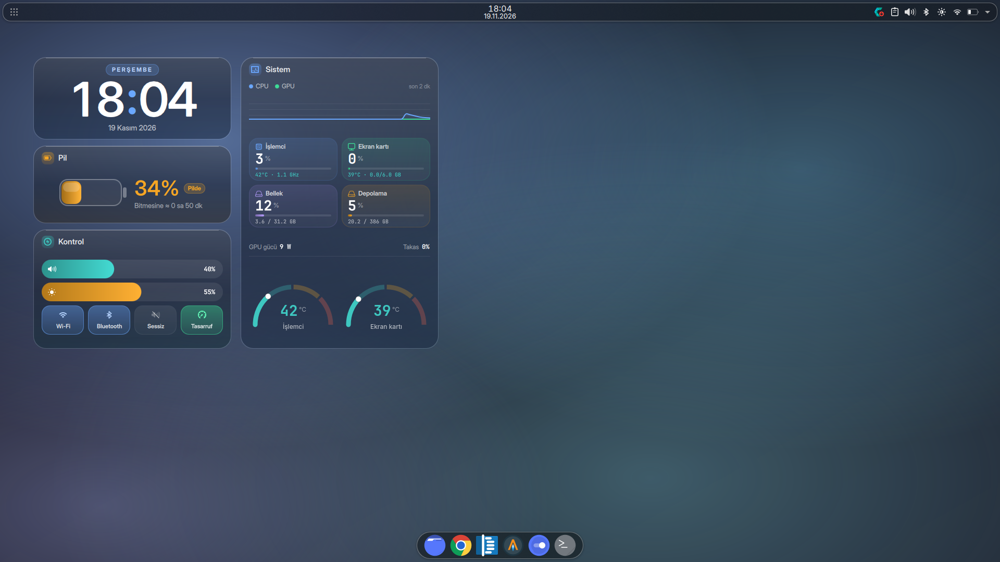

# island-desktop

Koyu, mavi tonlu, cam görünümlü bir **KDE Plasma 6** masaüstü. *(English: a dark blue glass KDE Plasma 6 setup with a pill dock, rounded windows, acrylic blur and a custom desktop dashboard.)*



## İçindekiler
- **Hap biçimli dock** (masaüstü boşken görünür, pencere önüne gelince saklanır) ve yuvarlak köşeli üst bar — [Panel Colorizer](https://github.com/luisbocanegra/plasma-panel-colorizer) ile
- **Tüm pencerelerde yuvarlak köşe + akrilik blur** — KWin eklentileri *Rounded Corners* ve *Better Blur DX*
- **Island Dash**: kendi yazdığım iki sütunlu masaüstü widget'ı
  - Sol: saat/tarih, pil (kapsül + kalan süre + fare/klavye pili), kontrol (ses, parlaklık, Wi-Fi / Bluetooth / sessiz / güç modu)
  - Sağ: **Sistem** kartı — CPU/GPU geçmiş grafiği, işlemci/ekran kartı/bellek/depolama kutuları (sıcaklık, GHz, VRAM, GB), GPU gücü, swap, disk G/Ç ve renk bölgeli **sıcaklık skalası**
- Catppuccin Mocha Blue renkleri, Kvantum stili, Tela Circle uygulama ikonları, iOS tarzı durum ikonları (`IslandIcons`), Inter + JetBrains Mono fontları
- İsteğe bağlı **pil/AC güç profili** otomasyonu (`--power`)

## Gereksinimler
- KDE Plasma **6** (Wayland üzerinde denendi), `sudo`, internet
- Dağıtım paket yöneticisi: pacman / apt / dnf / zypper (otomatik algılanır)

## Kurulum
```bash
git clone https://github.com/siimsek/island-desktop.git
cd island-desktop
./install.sh                 # tema + KWin efektleri + widget + ayarlar
./install.sh --power         # + pil/AC güç ayarları (dizüstü, sudo ister)
./install.sh --skip-effects  # KWin efektlerini derleme
./install.sh --no-apply      # dosyaları kur ama panellerine/ayarlarına dokunma
```
Bittiğinde **oturumu kapatıp açın**. Başarısız olan adımlar sonda listelenir; betik tek bir hatada durmaz.

> **Dikkat:** `apply-settings.sh` mevcut panellerini **siler** ve yenilerini kurar (üst bar + dock) ve masaüstündeki widget'ları kaldırıp Island Dash'i ekler. Önce yedek almak istersen `--no-apply` kullan.

Kaldırmak için: `./uninstall.sh` (güç ayarları için `./uninstall.sh --power`).

## Yapı
| Yol | Ne işe yarar |
|---|---|
| `install.sh` / `uninstall.sh` | Kurulum / geri alma |
| `scripts/apply-settings.sh` | Renk, ikon, imleç, font, KWin efekt ayarları, paneller, widget yerleşimi |
| `scripts/build-kwin-effects.sh` | KWin efektlerini **bu makinedeki KWin'e karşı** derler |
| `plasmoid/org.local.islanddash/` | Island Dash (QML) |
| `plasma/desktoptheme/Island2/` | Dock'taki aktif uygulama çerçevesini kaldıran Plasma teması |
| `panels/*.json` | Panel Colorizer ayarları (dock, üst bar) |
| `power/` | AC/pil betiği, udev kuralı, Wi-Fi güç tasarrufu |
| `konsole/`, `wallpapers/`, `kvantum/` | Konsole renkleri, duvar kağıdı, Kvantum cam ayarı |

## Bilinen kısıtlar (dürüst notlar)
- **Test edilen ortam:** yalnızca CachyOS (Arch), Plasma 6.8, Wayland, NVIDIA+Intel hibrit dizüstü. Debian/Ubuntu/Fedora/openSUSE paket adları ve `install.sh`'ın bu dağıtımlardaki akışı **denenmedi**.
- **`install.sh` baştan sona temiz bir sistemde çalıştırılmadı.** Parçaları (ikon üretimi, indirme adresleri, Plasma betiği üretimi) ayrı ayrı ve sahte komutlarla doğrulandı.
- **KWin efektleri her KWin güncellemesinde yeniden derlenmeli.** Hazır paketler KWin sürümü değişince *"built for a different version of KWin"* hatası verir. Çözüm: `scripts/build-kwin-effects.sh`.
- **Better Blur ayar grubu `Effect-better-blur-dx`** (tireli). Alt çizgi yazılırsa ayarlar sessizce yok sayılır.
- **Widget zeminindeki blur gerçek değil.** Plasma masaüstü widget'ları arkadaki duvar kağıdını bulanıklaştıramaz; cam görünümü yarı saydam katman + parlak kenarla taklit edilir. Pencerelerde blur gerçektir.
- **Sensörler donanıma bağlıdır:** GPU sensörü NVIDIA için `gpu/gpu0/*` kullanır. Farklı donanımda `kstatsviewer --list` ile kimlikleri kontrol edip `plasmoid/.../contents/ui/main.qml` içindeki `sensorId` değerlerini değiştirin.
- **Fare/klavye pili** UPower'dan gelir; bazı USB alıcılı cihazlarda UPower görmez (Logitech için `solaar`) ve bazı cihazlar tutarsız yüzde bildirir.
- **Titremesiz değerler:** ekranda gösterilen sayılar üstel ortalama + eşik (hysteresis) ile güncellenir; pil süresi 5 dakikalık adımlarla yuvarlanır. Sensörler 2–30 sn sınırlıdır.
- Widget'ın düğmeleri (`ctl.sh`) `wpctl`, `nmcli`, `bluetoothctl`, `powerprofilesctl`, `qdbus6` kullanır; eksik olanın düğmesi çalışmaz.

## Sorun giderme
- **Widget "Sorry! There was an error loading Island Dash" diyor:** `journalctl --user -b | grep islanddash` — QML hatasını verir.
- **Pencereler şeffaf/bulanık değil:** `qdbus6 org.kde.KWin /Effects isEffectLoaded better_blur_dx` ve `kwin4_effect_shapecorners` — `false` ise efekti yeniden derleyin.
- **Sol üst köşe hâlâ pencereleri açıyor:** Sistem Ayarları → Çalışma Alanı → Ekran Kenarları.
- **Dock görünmüyor:** pencere dock'un üstüne biniyorsa saklanması normaldir (*dodge windows*).

## Gizlilik
Repo kişisel veri, şifre veya anahtar içermez. `install.sh` yalnızca bu README'deki GitHub depolarından ve dağıtımınızın paket depolarından indirir.

## Lisans
Kendi dosyalarım MIT. İndirilen temalar/eklentiler kendi lisanslarına tabidir (Catppuccin: MIT, WhiteSur/Tela: GPL-3.0, Panel Colorizer: GPL-3.0, KDE-Rounded-Corners: GPL-3.0, Better Blur DX: GPL-3.0).
